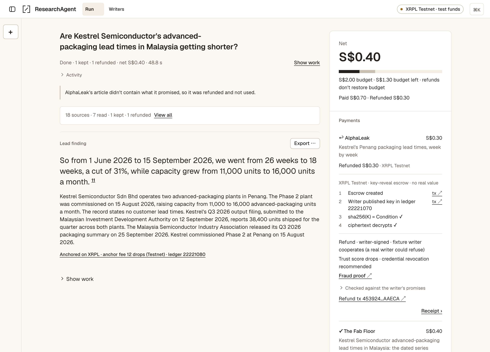

<p align="center">
  <picture>
    <source media="(prefers-color-scheme: dark)" srcset="design/brand/lockup-on-dark.svg">
    
  </picture>
</p>

<h3 align="center">Research with a wallet.</h3>

<p align="center">
  ResearchAgent answers from free sources first, then pays writers for the articles it is still missing,
  over x402 on the XRP Ledger, inside a budget you set. A model recommends; only policy code can pay.
</p>

<p align="center">
  <a href="https://ra-front-651013803640.asia-southeast1.run.app"><b>Try it live →</b></a>
  &nbsp;·&nbsp;
  <a href="https://collaboration95.github.io/theFastandtheFungible/demo/">Watch a recorded run</a>
  &nbsp;·&nbsp;
  <a href="https://collaboration95.github.io/theFastandtheFungible/progress/">Progress since SingHacks</a>
</p>

<p align="center">
  <a href="https://github.com/Collaboration95/theFastandtheFungible/releases/latest"></a>
  <a href="LICENSE"></a>
  <a href="docs/x402-xrpl.md"></a>
</p>

The live sandbox is open **13–19 Nov 2026** on XRPL Testnet with no real value and nothing to
install. The recorded run works any time. Or run the whole money path yourself, with no clone and
no account (Node ≥ 22.13):

```sh
REL=https://github.com/Collaboration95/theFastandtheFungible/releases/download/v1.0.2
npx -y $REL/researchagent-mcp-1.0.2.tgz try --testnet
```

<p align="center">
  
</p>
<p align="center"><sub>A run recorded on XRPL Testnet on 11 Nov 2026, replayed in the current app · fixture models · fictional writers · no real value · <a href="docs/evidence/replay-nov11/README.md">its six transactions</a></sub></p>

## What it does

- **Ask with a budget.** From the browser, Claude Code or Codex over MCP, TypeScript or Python,
  or the Mac app. Every question carries its own spending limit.
- **Free sources first, then buy only what fills the gap.** Writers search their own articles and
  sign promises about what each one contains. A decision model, weighted by each writer's trust
  score, judges which paid article is worth it: at most one per round, up to three rounds.
- **The writer is paid by revealing the key.** Policy code locks payment in a native XRPL escrow
  that only the article's key can open. Publishing the key on the ledger is what pays the writer,
  so delivery and payment are one event.
- **Every claim has a receipt.** The answer cites the exact passages it bought. A broken promise
  is refunded, each answer is anchored on the ledger, and anyone can re-check the receipts offline.

## How it works


Key reveal makes *delivery* atomic, not quality: if an article breaks its promise after the key is
out, the refund is a payment the writer signs. Our fixture writer cooperates; a real one could
refuse, so the buyer keeps a fraud proof anyone can check and the writer's trust score drops.
[Mechanism](docs/key-reveal-escrow.md) · [architecture](docs/capabilities.md#how-a-run-works).

### Hard guarantees

Every gate has regression tests and a [read-only audit rule](scripts/gate-audit.ts):

| Guarantee | Enforcement test | Audit rule |
|---|---|---|
| No premium bytes before a grant | [Purchase boundary](tests/purchase.test.ts), [raw leak audit](tests/gate-audit.test.ts) | `premium_leak` |
| Only policy code spends, within the prompt budget | [Budget and stop cases](tests/purchase.test.ts) | `purchase_without_policy`, `over_budget` |
| One charge per intent | [Parallel pays and restart cases](tests/purchase.test.ts) | `duplicate_settlement` |
| Real citations to delivered passages | [Grant and proof cases](tests/purchase.test.ts) | `citation_without_verified_grant` |
| Simulated or substituted work is labelled | [Rail label regression](tests/gate-audit.test.ts) | `missing_rail_label` |

## Use it from your agent

Give Claude Code a research wallet on XRPL Testnet. The caps live in the environment, where the
calling model cannot raise them:

```sh
claude mcp add researchagent -e MCP_MAX_BUDGET_MINOR=200 -e MCP_DAILY_CAP_MINOR=500 -- npx -y https://github.com/Collaboration95/theFastandtheFungible/releases/download/v1.0.2/researchagent-mcp-1.0.2.tgz --testnet
```

Or call it from code:

```sh
npm i https://github.com/Collaboration95/theFastandtheFungible/releases/download/v1.0.2/researchagent-sdk-1.0.2.tgz
pip install https://github.com/Collaboration95/theFastandtheFungible/releases/download/v1.0.2/researchagent-1.0.2-py3-none-any.whl
```

- **Agent hires agent.** Another agent pays ResearchAgent over x402, and cited writers get
  royalties. In source today (`make try-hire` from a clone); `try --testnet --hire` ships in the
  next release · [how](docs/hire.md).
- **Writers.** A Markdown folder becomes a payable Testnet writer with an XRPL Credential in two
  commands · [publishing](docs/publishing.md).
- **Everything else:** Codex and Claude Desktop, TEST-SGD escrow, the zero-clone web app, the Mac
  app and a full checkout are in the [install guide](docs/install.md).

## Verify it yourself

<details>
<summary>Six Testnet transactions from one recorded run, and how to re-check them</summary>

| Step | Transaction on XRPL Testnet |
|---|---|
| Escrow created for AlphaLeak (fictional writer) | [319923F5…2AA3EB](https://testnet.xrpl.org/transactions/319923F5F4863F3E1505424E6FC8F20B365E7A926F1086197CB68DF6842AA3EB) |
| Key published; the article then broke its promise | [57BA72D4…EC4B2B8C](https://testnet.xrpl.org/transactions/57BA72D45D4A6B39097B678E06CF9F8FF38F426879791138461425CEEC4B2B8C) |
| Refund, signed by the writer | [BB71016D…16B2DA82](https://testnet.xrpl.org/transactions/BB71016D63ACF759E8C5B4B99E118C17DDD1E7C01F3770327C5C316864B2DA82) |
| Escrow created for The Fab Floor (fictional writer) | [7FC899B5…6CA94C60](https://testnet.xrpl.org/transactions/7FC899B54AC439BB7FC3DC7BF9A57837FB06BAECF998D92F86841DA61CA94C60) |
| Key published · sha256(K) = Condition ✓ | [8A8A3A8E…A947E366](https://testnet.xrpl.org/transactions/8A8A3A8E1770BE5FD5FD5192DF1C37E84854320373D91BDBB4D806E5A947E366) |
| Answer anchored (memo = audit head) | [7501BAD9…F37A4BE1](https://testnet.xrpl.org/transactions/7501BAD9994552932D7F52AA96A53313163207C86438C9C01D33B069F37A4BE1) |

Re-check the whole run with Python and no Node (read-only lookups on s.altnet), after the
`pip install` above:

```sh
curl -LO https://raw.githubusercontent.com/Collaboration95/theFastandtheFungible/v1.0.2/docs/evidence/lane-b3/UC3.receipts.json
researchagent verify UC3.receipts.json --ledger
```

It ends with `RESULT PASS`. The [ledger page](https://collaboration95.github.io/theFastandtheFungible/ledger/)
re-validates all <!--f:transactions-->61<!--/f--> recorded Testnet transactions from your browser.
TypeScript and Python verifiers, written separately, agree on all <!--f:vectors-->224<!--/f-->
shared conformance cases ([receipt format](docs/receipt-spec.md)).

</details>

## Numbers

| What we measured | Result | Scope and date |
|---|---|---|
| Blind held-out judge questions (<!--f:heldout_bank-->v5<!--/f-->) | <!--f:heldout-->16/20<!--/f--> bought and cited; <!--f:offtopic-->0/10<!--/f--> off-topic purchases; <!--f:heldout_violations-->0<!--/f--> gate violations | run once on <!--f:heldout_on-->11 Nov<!--/f-->; fixture decision model, team-authored writers, XRPL Testnet |
| One line to a verified purchase | <!--f:try_s-->84.2<!--/f--> s cold; <!--f:try_misses-->2 of 4<!--/f--> cold runs overran 90 s | one Mac, empty npm cache, 7 Nov |
| Network fees per key-reveal purchase | <!--f:fee_drops-->435<!--/f--> drops | XRPL Testnet, measured |
| Progress since SingHacks | <!--f:prs-->248<!--/f--> PRs merged since <!--f:since-->21 Sep<!--/f-->; <!--f:releases-->13<!--/f--> releases | counted at <!--f:sha-->329b64f7<!--/f--> on <!--f:as_of-->11 Nov 2026<!--/f--> |

Development banks we tuned on, the synthetic-corpus scorecard, cost and latency:
[docs/numbers.md](docs/numbers.md). What shipped when, with the misses we kept:
[progress page](https://collaboration95.github.io/theFastandtheFungible/progress/).

## Builder feedback

<!--f:feedback_line-->7 ranked findings with runnable repros · 35 numbered findings (B01–B35) · 15 submissions on 4–5 Sep · 8 upstream drafts, 0 filed<!--/f-->.
The top three: the RLUSD issuer lacks the flag that token escrow needs; an issued amount must be
checked as the delivered amount; a signed IOU quote overflowed the 1 KiB Memo limit.
[Read it in 90 seconds](docs/BUILDER-FEEDBACK.md) · [mainnet checklist](docs/BUILDER-FEEDBACK.md#mainnet-readiness-checklist).

## Status and limits

- **XRPL Testnet only, no real value.** Mainnet is disabled in code; readiness is a
  [checklist](docs/BUILDER-FEEDBACK.md#mainnet-readiness-checklist), not a claim.
- **Writers.** The research writers are fictional. One team-authored writer (our own XRPL build
  notes) is labelled as ours and is not independent. No independent writers yet: consenting writers
  will be listed as **real person · Testnet · no real value** ([list](docs/evidence/real-writers.json)).
- **New writers get one labelled probe.** A new writer's best matching article may get one probe
  purchase of up to S$0.30 inside your budget, shown as *probe purchase · new writer*.
- **TEST-SGD stands in for RLUSD** in token escrow; official RLUSD payments work on Testnet.
- **Live sandbox.** One shared Testnet payer, per-visitor caps, owner controls off; each answer
  says whether its models ran live or as a labelled fixture fallback. Open 13–19 Nov 2026.
- **Packages** are on GitHub Releases, not yet on npm, PyPI or the MCP Registry. The Mac app is an
  unsigned DMG.
- `theFastandtheFungible` is the team and repository name; the product is **ResearchAgent**.

[Docs](docs/README.md) · [Install](docs/install.md) · [Capabilities](docs/capabilities.md) ·
[Numbers](docs/numbers.md) · [Engineering](docs/engineering.md) ·
[Progress](https://collaboration95.github.io/theFastandtheFungible/progress/) ·
[Deck (PDF)](docs/submission/ResearchAgent-SFF-deck.pdf) ·
[Explainers](https://collaboration95.github.io/theFastandtheFungible/) ·
[Changelog](CHANGELOG.md) · [Contributing](.github/CONTRIBUTING.md) · [Security](.github/SECURITY.md) ·
[MIT license](LICENSE)
<!-- Video slot: once the demo video is uploaded, add a "Video" link after "Progress" in the line above (see VIDEO_URL in docs/submission/README.md). -->
