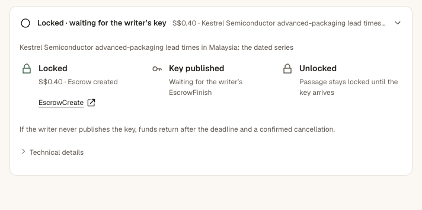
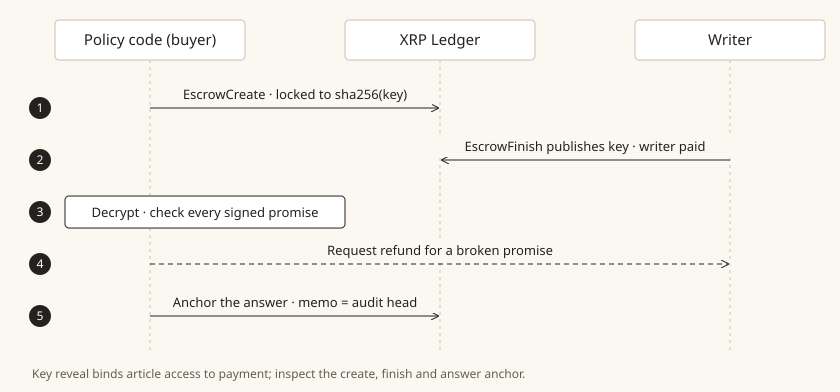

ResearchAgent is a search engine for agent-readable expertise, with a wallet. **The Fast and the Fungible** is our team and repository name.

<p align="center"></p>
<h3 align="center">Paid on delivery. Proven on the ledger.</h3>

Ask a question and set a budget. ResearchAgent searches free sources, the real XRPL and x402 documentation cited by URL, <!-- HOSTED-PENDING -->
then policy rules decide which missing evidence to buy. The key that unlocks the article
is the same key that releases the writer’s payment. Your browser checks the match.

**XRPL Testnet demo · 13–19 Nov 2026.**

[Try the demo](https://collaboration95.github.io/theFastandtheFungible/try/) ·
[Verify a recorded run](https://ra-front-651013803640.asia-southeast1.run.app) ·
[Watch the replay](https://collaboration95.github.io/theFastandtheFungible/demo/) ·
[Watch an answer from the real docs](https://collaboration95.github.io/theFastandtheFungible/demo/?scenario=UC-real-content) <!-- HOSTED-PENDING -->

| Real purchases | Crash and retry schedules | Protocol states checked | Attacks tried |
|---|---|---|---|
| **<!--f:proof_purchases-->1,000<!--/f-->** real, each re-read from a public node | **<!--f:proof_schedules-->1,000,000<!--/f-->** simulated, no violation | **<!--f:proof_states-->210,480<!--/f-->**, no violation | **<!--f:proof_attacks-->34<!--/f-->**, no breach |

<p align="center"></p>
<p align="center"><sub><a href="https://collaboration95.github.io/theFastandtheFungible/demo/">Recorded replay</a>, sample writers: locked → key published → article unlocked (waiting shortened).</sub></p>

<p align="center">
<a href="https://github.com/Collaboration95/theFastandtheFungible/releases/latest"></a>
<a href="LICENSE"></a>
<a href="docs/key-reveal-escrow.md"></a>
</p>

<p align="center"></p>

## How it works



1. **Ask with a budget.** Confirm the plan in a five-second action sheet.
2. **Search free sources first.** Writers return abstracts and signed promises.
3. **Buy missing evidence.** Only policy code pays, at most one article per round for three rounds.
4. **Check the key and cite.** The app grants access after the escrow finish validates;
   the browser hashes the published key against the escrow lock.

### Hard guarantees

Every gate has regression tests and a [read-only audit rule](scripts/gate-audit.ts):

| Guarantee | Enforcement test | Audit rule |
|---|---|---|
| No premium bytes before a grant | [Purchase boundary](tests/purchase.test.ts), [raw leak audit](tests/gate-audit.test.ts) | `premium_leak` |
| Only policy code spends, within the prompt budget | [Budget and stop cases](tests/purchase.test.ts) | `purchase_without_policy`, `over_budget` |
| One charge per intent | [Parallel pays and restart cases](tests/purchase.test.ts) | `duplicate_settlement` |
| Real citations to delivered passages | [Grant and proof cases](tests/purchase.test.ts) | `citation_without_verified_grant` |
| Simulated or substituted work is labelled | [Rail label regression](tests/gate-audit.test.ts) | `missing_rail_label` |

## Real sources, signed on the ledger

- **Free tier:** <!--f:content_passages-->12,104<!--/f--> passages from the XRPL and x402 documentation, each cited by its real page URL. <!-- HOSTED-PENDING -->
- **Paid tier:** ledger-analytics reports on RLUSD and project accounts, each signed “as of validated ledger N” so you can check it on the public explorer. Two team-authored writers add practitioner notes.

[Content evidence](docs/evidence/content/CONTENT.md) · [Publish your notes](docs/publishing.md).

## Proof at scale

- **<!--f:proof_purchases-->1,000<!--/f--> real purchases** ran through the product’s escrow service. An independent script re-read every transaction from a public node: median <!--f:proof_p50_s-->20.3<!--/f--> s end to end. Rerun it with `npm run proof:testnet-verify`. [Details](docs/evidence/proof/TESTNET-1000.md).
- A model checker covered <!--f:proof_states-->210,480<!--/f--> protocol states and caught all <!--f:proof_mutations-->seven<!--/f--> seeded bugs. <!--f:proof_schedules-->1,000,000<!--/f--> simulated crash and retry schedules and <!--f:proof_attacks-->34<!--/f--> attacks found no violation or breach. [Report](docs/evidence/proof/PROOF-REPORT.md).
- Ledger-stream waits cut settlement p90 by 15.7%. [Speed](docs/evidence/speed/SPEED.md).

## Use it from your agent

Connect by URL: the hosted demo speaks MCP over HTTP at `https://ra-front-651013803640.asia-southeast1.run.app/mcp`, and the app’s connect panel adds it to Cursor, VS Code or Claude in one click. <!-- HOSTED-PENDING -->
Agents can also buy answers over x402 at `/v1/ask`. <!-- HOSTED-PENDING -->
Sellers add key-reveal delivery with Express, Hono or FastAPI packages; a separate Python buyer completed a real purchase against one. [Reach evidence](docs/evidence/reach/REACH.md).

Locally, give Claude Code the same tools; the calling model cannot raise environment caps:

```sh
claude mcp add researchagent -e MCP_MAX_BUDGET_MINOR=200 -e MCP_DAILY_CAP_MINOR=500 -- npx -y https://github.com/Collaboration95/theFastandtheFungible/releases/download/v1.1.1/researchagent-mcp-1.1.1.tgz --testnet
```

Or run the full purchase-and-verification path (Node ≥ 22.13):

```sh
REL=https://github.com/Collaboration95/theFastandtheFungible/releases/download/v1.1.1
npx -y $REL/researchagent-mcp-1.1.1.tgz try --testnet
```

```sh
npm i https://github.com/Collaboration95/theFastandtheFungible/releases/download/v1.1.1/researchagent-sdk-1.1.1.tgz
pip install https://github.com/Collaboration95/theFastandtheFungible/releases/download/v1.1.1/researchagent-1.1.1-py3-none-any.whl
```

[Install guide: TypeScript, Python, web and Mac](docs/install.md) ·
[Agent hires agent, with writer royalties](docs/hire.md).

## Anyone can publish a paid note

Write a note on your phone, pass moderation and it goes live in <!--f:publish_live_s-->12.4<!--/f--> s, with a verified sale after <!--f:publish_sale_s-->34.5<!--/f--> s, measured locally. <!-- HOSTED-PENDING -->
Optional regulated mode admits credentialed writers only, screens payees against a pinned OFAC XRP list and audits every zero-charge refusal. [Evidence](docs/evidence/publish/PUBLISH.md).

## Watch every purchase

The `/live` page shows each validated escrow and key check, and the scoreboard separates outside visitors from operator tests. <!-- HOSTED-PENDING -->
Search runs locally with no model API. <!-- HOSTED-PENDING -->
[Feed](docs/evidence/feed/FEED.md) · [Search models](docs/evidence/models/MODELS.md).

## Verify it yourself

Open **Home → Verify → Run the checks**. The featured 12 Nov run shows all five
gates Held: browser/TS **<!--f:featured_browser-->24<!--/f--> passed, 0 failed, 2 not checked**;
Python **<!--f:featured_wheel-->25<!--/f--> passed, 0 failed, 2 skipped**.
The run bought one S$0.40 article in <!--f:featured_seconds-->31.1<!--/f--> s Start→Done,
(planning and modal excluded); its initial draft used fixture extracts and keyword search.
[Its receipts and ledger checks](docs/evidence/hosted-export-nov12/README.md).

Export any run’s receipts to check them outside the app. Separately written
TypeScript and Python verifiers agree on <!--f:vectors-->224<!--/f--> conformance cases.
[Receipt format](docs/receipt-spec.md) · [Public ledger page](https://collaboration95.github.io/theFastandtheFungible/ledger/).

## Hosted usage so far

Hosted demo since 11 Nov, team test runs included, as of <!--f:live_asof-->12 Nov 2026, 12:24 SGT<!--/f-->:
<!--f:live_questions-->62<!--/f--> questions, <!--f:live_purchases-->74<!--/f--> settled purchases; median <!--f:live_median_s-->22.316<!--/f--> s and p90 <!--f:live_p90_s-->61.061<!--/f--> s across <!--f:live_timing_n-->49<!--/f--> timed runs; median model cost US$<!--f:live_model_usd-->0.0020035<!--/f--> per question; <!--f:live_violations-->0<!--/f--> recorded gate violations across <!--f:live_audits-->50<!--/f--> audited runs (<!--f:live_audit_unavailable-->12<!--/f--> audits unavailable).
[Snapshot and definitions](docs/submission/evidence/hosted-stats-nov12/README.md) ·
[Live scoreboard](https://ra-front-651013803640.asia-southeast1.run.app/api/demo/stats).
Model cost is separate from article prices and ledger fees.

## Progress and builder feedback

<!--f:prs-->308<!--/f--> pull requests merged since <!--f:since-->21 Sep<!--/f-->;
<!--f:releases-->15<!--/f--> releases, counted at <!--f:sha-->c50199e5<!--/f--> on
<!--f:as_of-->12 Nov 2026<!--/f-->.

**RLUSD cannot be escrowed today.** Ripple’s official RLUSD issuers have escrow locking switched off on both networks, so we show the ledger’s verdict before signing. Spikes also showed that a visitor can delegate escrow creation alone, and that an outer Batch reports success when its inner transactions roll back. Five more upstream items with hashes and three patches are ready to file. [Spikes](docs/evidence/money/SPIKES.md) · [Bundle](docs/feedback/upstream/r3/README.md).

<!--f:feedback_line-->7 ranked findings with runnable repros · 35 numbered findings (B01–B35) · 15 submissions on 4–5 Sep · 8 upstream drafts, 0 filed<!--/f-->.

[Progress since SingHacks](https://collaboration95.github.io/theFastandtheFungible/progress/) ·
[Reproducible builder feedback](docs/BUILDER-FEEDBACK.md).

## Status and limits

- **Environment and assets.** This is a development network; mainnet signing is disabled.
  The live demo pays in XRP. The CLI’s TEST-SGD is an unbacked stand-in for RLUSD: recorded
  unsigned RLUSD escrow probes returned `tecNO_PERMISSION` on both networks, while the
  matched TEST-SGD control succeeded. [Recorded verdicts](docs/evidence/dry-run-nov12/README.md).
- **Market.** No outside customers, pilots or revenue yet. The <!--f:proof_purchases-->1,000<!--/f--> purchases above are
  scripted repeats of one team-authored note by fresh accounts. Demand among
  XRPL/x402 integrators using coding agents is not yet validated.
- **Delivery and refunds.** Signed submission can expose the key before validation;
  escrow stays claimable until CancelAfter. A key match proves reveal, not quality.
  Quality refunds need the writer’s signature and cooperation; a real writer could refuse.
  No-show recovery requires a validated EscrowCancel after the deadline.
- **Identity.** Three accepted operator-issued Credentials and an operator-issued
  Permissioned Domain support identity display only, not KYC, quality or payment permission.
- **Operations.** One shared payer, visitor caps and labelled per-run model fallbacks.
  Cold installs depend on npm and faucet latency; [timings and misses](docs/submission/qa-prep.md).
  Packages are on GitHub Releases; registry publication and Mac signing remain pending.
  The OFAC screen is one dated list, not a clearance; a regulated launch also needs custody, KYB and licensing.

[Docs](docs/README.md) · [Numbers](docs/numbers.md) · [Deck (PDF)](docs/submission/ResearchAgent-SFF-deck.pdf) ·
[Q&A](docs/submission/qa-prep.md) · [Contributing](.github/CONTRIBUTING.md) · [Security](.github/SECURITY.md) · [MIT license](LICENSE)
