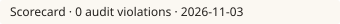
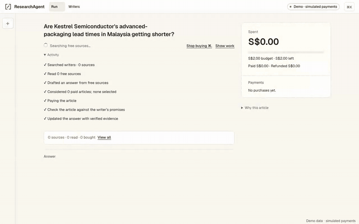
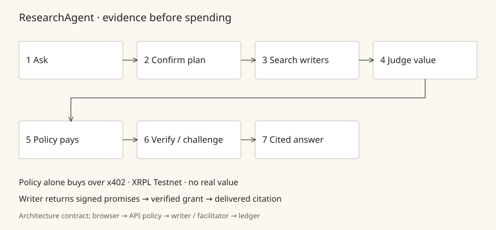

<p align="center">
  <picture>
    <source media="(prefers-color-scheme: dark)" srcset="design/brand/lockup-on-dark.svg">
    
  </picture>
</p>

<h3 align="center">Research with a wallet.</h3>

<p align="center">ResearchAgent answers from free sources, then buys the missing evidence from writers over x402 on XRPL, inside a budget you set.</p>

```sh
npx -y https://github.com/Collaboration95/theFastandtheFungible/releases/download/v1.0.0/researchagent-mcp-1.0.0.tgz try --testnet
```

Team-authored build notes and fictional demo writers; no independent writers yet. Testnet only · no real value.

<p align="center">
  
</p>

<p align="center">
  <a href="https://collaboration95.github.io/theFastandtheFungible/demo/">Try it in your browser</a> ·
  <a href="https://collaboration95.github.io/theFastandtheFungible/">Explainers</a> ·
  <a href="https://collaboration95.github.io/theFastandtheFungible/talk/">Walkthrough</a> ·
  <a href="https://github.com/Collaboration95/theFastandtheFungible/releases/tag/v1.0.0">Download for Mac</a> ·
  <a href="docs/README.md">Docs</a> ·
  <a href="CHANGELOG.md">Changelog</a>
</p>

<p align="center">
  <a href="https://github.com/Collaboration95/theFastandtheFungible/actions/workflows/ci.yml"></a>
  <a href="https://codespaces.new/Collaboration95/theFastandtheFungible"></a>
  <a href="https://codespaces.new/Collaboration95/theFastandtheFungible?devcontainer_path=.devcontainer%2Ftestnet%2Fdevcontainer.json"></a>
  <a href="#numbers"></a>
  <a href="https://github.com/Collaboration95/theFastandtheFungible/releases/tag/v1.0.0"></a>
  <a href="LICENSE"></a>
  <a href="docs/x402-xrpl.md"></a>
</p>



Recorded on XRPL Testnet · no real value · [verify these 6 hashes live](https://collaboration95.github.io/theFastandtheFungible/demo/).
Fictional writers and fixture models. Key reveal makes *delivery* atomic; the refund after a broken promise is writer-signed (the fixture writer cooperates, a real one could refuse).

### Verify in 30 s

| Transaction | Explorer |
|---|---|
| Escrow created, AlphaLeak | [319923F5F4863F3E1505424E6FC8F20B365E7A926F1086197CB68DF6842AA3EB](https://testnet.xrpl.org/transactions/319923F5F4863F3E1505424E6FC8F20B365E7A926F1086197CB68DF6842AA3EB) |
| EscrowFinish, key published (article then failed its promise) | [57BA72D45D4A6B39097B678E06CF9F8FF38F426879791138461425CEEC4B2B8C](https://testnet.xrpl.org/transactions/57BA72D45D4A6B39097B678E06CF9F8FF38F426879791138461425CEEC4B2B8C) |
| Refund (writer-signed) | [BB71016D63ACF759E8C5B4B99E118C17DDD1E7C01F3770327C5C316864B2DA82](https://testnet.xrpl.org/transactions/BB71016D63ACF759E8C5B4B99E118C17DDD1E7C01F3770327C5C316864B2DA82) |
| Escrow created, The Fab Floor | [7FC899B54AC439BB7FC3DC7BF9A57837FB06BAECF998D92F86841DA61CA94C60](https://testnet.xrpl.org/transactions/7FC899B54AC439BB7FC3DC7BF9A57837FB06BAECF998D92F86841DA61CA94C60) |
| EscrowFinish, key published · sha256(K) = Condition ✓ (checked in your browser on /demo/) | [8A8A3A8E1770BE5FD5FD5192DF1C37E84854320373D91BDBB4D806E5A947E366](https://testnet.xrpl.org/transactions/8A8A3A8E1770BE5FD5FD5192DF1C37E84854320373D91BDBB4D806E5A947E366) |
| Answer anchor (memo = audit head) | [7501BAD9994552932D7F52AA96A53313163207C86438C9C01D33B069F37A4BE1](https://testnet.xrpl.org/transactions/7501BAD9994552932D7F52AA96A53313163207C86438C9C01D33B069F37A4BE1) |

Or check the whole run with no Node: [receipts.json](docs/evidence/lane-b3/UC3.receipts.json), then `curl -LO https://raw.githubusercontent.com/Collaboration95/theFastandtheFungible/v1.0.0/docs/evidence/lane-b3/UC3.receipts.json && researchagent verify UC3.receipts.json --ledger` (`pip install` line below).


## What it does

- **Agents ask.** From Claude Code, Codex, a Python or TypeScript program, or the Mac app, with a budget per question.
- **A decision model judges** which paid article is worth buying (OpenAI Decisions `gpt-6-luna` or Cloudflare Clef-flash), weighted by writer trust.
- **Deterministic policy code pays** the writers over x402 on XRPL Testnet, in XRP or RLUSD, within the budget. The model cannot spend.
- **Every claim has a receipt** you can verify offline: the exact delivered passage, the writer's signature, the payment, and any refund.

## Hard guarantees

Every gate has regression tests and a corresponding [read-only audit rule](scripts/gate-audit.ts):

| Guarantee | Enforcement test | Audit rule |
|---|---|---|
| No premium bytes before a grant | [Purchase boundary](tests/purchase.test.ts), [raw leak audit](tests/gate-audit.test.ts) | `premium_leak` |
| Only policy code spends, within the prompt budget | [Budget and stop cases](tests/purchase.test.ts) | `purchase_without_policy`, `over_budget` |
| One charge per intent | [Parallel pays and restart cases](tests/purchase.test.ts) | `duplicate_settlement` |
| Real citations to delivered passages | [Grant and proof cases](tests/purchase.test.ts) | `citation_without_verified_grant` |
| Simulated or substituted work is labelled | [Rail label regression](tests/gate-audit.test.ts) | `missing_rail_label` |

## Use it from your agent

Run the whole judge path and exit (Node ≥ 22.13, XRPL Testnet only, no real value):

```sh
# Generated by node scripts/install-snippets.mjs --tag v1.0.0 --try
npx -y https://github.com/Collaboration95/theFastandtheFungible/releases/download/v1.0.0/researchagent-mcp-1.0.0.tgz try --testnet
```

`try` runs UC3 with a S$2 cap, key reveal, writer-signed refund, re-buy, anchor and read-only ledger verification. Faucet failure produces a labelled SIMULATED run with its reason.

[Release v1.0.0](https://github.com/Collaboration95/theFastandtheFungible/releases/tag/v1.0.0): release · not yet on npm/PyPI/MCP Registry. Install without cloning.

```sh
npm i https://github.com/Collaboration95/theFastandtheFungible/releases/download/v1.0.0/researchagent-sdk-1.0.0.tgz
pip install https://github.com/Collaboration95/theFastandtheFungible/releases/download/v1.0.0/researchagent-1.0.0-py3-none-any.whl
claude mcp add researchagent -e MCP_MAX_BUDGET_MINOR=200 -e MCP_DAILY_CAP_MINOR=500 -- npx -y https://github.com/Collaboration95/theFastandtheFungible/releases/download/v1.0.0/researchagent-mcp-1.0.0.tgz
```

Real XRPL Testnet payments with no clone, **release v1.0.0 · not yet on npm/PyPI/MCP Registry**: faucet wallets are made on first use, key-reveal escrow and an answer anchor are on, models and writers are fixtures, and there is no real value. `ask_expert` returns explorer links for create, finish, refund and anchor; `wallet_status` shows `rail: xrpl-testnet`. Caps stay operator-set (default zero). If the faucet is down you get a labelled SIMULATED fallback with a reason, not silence.

```sh
# Generated by node scripts/install-snippets.mjs --tag v1.0.0 --testnet
claude mcp add researchagent -e MCP_MAX_BUDGET_MINOR=200 -e MCP_DAILY_CAP_MINOR=500 -- npx -y https://github.com/Collaboration95/theFastandtheFungible/releases/download/v1.0.0/researchagent-mcp-1.0.0.tgz --testnet
```
```sh
# Generated by node scripts/install-snippets.mjs --tag v1.0.0 --testnet --iou
claude mcp add researchagent -e MCP_MAX_BUDGET_MINOR=200 -e MCP_DAILY_CAP_MINOR=500 -- npx -y https://github.com/Collaboration95/theFastandtheFungible/releases/download/v1.0.0/researchagent-mcp-1.0.0.tgz --testnet --iou
```

TEST-SGD (our Testnet IOU, no real value, stand-in for RLUSD; included in v1.0.0): append `--iou` to either Testnet command (or set `ESCROW_ASSET=test-iou`). First cold call took 134.1 s, including 102.9 s issuer/trust-line provisioning; cache reused thereafter ([7 Nov review extract](docs/evidence/r5-r/review-timings.txt), [#384](https://github.com/Collaboration95/theFastandtheFungible/pull/384)).


No MCP client? One command starts the app on real Testnet (also **release v1.0.0 · not yet on npm/PyPI/MCP Registry**; Node ≥ 22.13, no clone). It serves the web UI on `127.0.0.1` and prints the payer address, how to point the SDK at it and a daily cap (S$5.00 for Testnet). Add `--open` to launch your browser; drop `--testnet` for the labelled SIMULATED rail ([details](docs/testnet.md#zero-clone-testnet-app-v100)).

```sh
# Generated by node scripts/install-snippets.mjs --tag v1.0.0 --app
npx -y https://github.com/Collaboration95/theFastandtheFungible/releases/download/v1.0.0/researchagent-mcp-1.0.0.tgz app --testnet
```

Clone/build alternatives and usage:

**TypeScript SDK** ([docs](docs/sdk.md)). `make release-artifacts` builds `dist/release/` and tests each file in a clean consumer, then:

```sh
npm i ./dist/release/researchagent-sdk-1.0.0.tgz   # exports createClient from @researchagent/sdk
```
```ts
import { createClient } from '@researchagent/sdk'
const client = createClient({ baseUrl: process.env.RA_URL, token: process.env.RA_API_TOKEN })
const run = await client.ask('What did the Kestrel–TSMC deal do to margins?', { budget: 2, idempotencyKey: 'q-1' })
console.log(run.answer, run.citations, run.receipts)
```

**Python SDK** ([docs](docs/sdk-python.md)). Python 3.10+, no runtime dependencies:

```sh
pip install "git+https://github.com/Collaboration95/theFastandtheFungible#subdirectory=packages/sdk-python"
python -m researchagent verify receipts.json --json   # offline, no Node, no network
```
```python
from researchagent import Client
client = Client('http://127.0.0.1:8788', token='YOUR_TOKEN')   # use the engine's RA_API_TOKEN
task = client.ask('What changed?', budget=2, idempotency_key='q-1')
print(task.result()['answer'])
```

**MCP** ([docs](docs/mcp.md)). Seven tools: `search_expertise`, `ask_expert`, `get_run`, `pause_spending`, `wallet_status`, `verify_answer`, `hire`.

```sh
claude mcp add researchagent -e MCP_MAX_BUDGET_MINOR=200 -e MCP_DAILY_CAP_MINOR=500 -- node --import "$PWD/node_modules/tsx/dist/loader.mjs" "$PWD/mcp/server.ts"
```

For the standalone package after `make release-artifacts`:

```sh
claude mcp add researchagent -e MCP_MAX_BUDGET_MINOR=200 -e MCP_DAILY_CAP_MINOR=500 -- npx -y "file:$PWD/dist/release/researchagent-mcp-1.0.0.tgz"
```

The command explicitly authorizes up to S$2 per question and S$5 per UTC day in fixture mode (simulated payments). Without those operator settings the caps stay zero. [HTTP from the Mac app](docs/mcp.md#app-hosted-streamable-http) gives each agent its own revocable allowance. For Claude Desktop, `ResearchAgent.mcpb` is attached to each [release](https://github.com/Collaboration95/theFastandtheFungible/releases/tag/v1.0.0); [Codex config and all clients](docs/mcp.md).

**Mac app** ([guide](desktop/README.md)). Download the unsigned DMG: [Apple Silicon](https://github.com/Collaboration95/theFastandtheFungible/releases/download/v1.0.0/ResearchAgent-1.0.0-arm64.dmg) or [Intel](https://github.com/Collaboration95/theFastandtheFungible/releases/download/v1.0.0/ResearchAgent-1.0.0-x64.dmg). Drag into Applications, then Finder → right-click → Open (or Privacy & Security → Open Anyway); see [signing notes](desktop/SIGNING.md). It starts offline with simulated payments, keeps keys in the macOS Keychain, and shows a recovery screen instead of crashing.

**Browser replay.** The [`/demo/`](https://collaboration95.github.io/theFastandtheFungible/demo/) page autoplays the key-reveal UC3: Recorded on XRPL Testnet · no real value, with a key published on the ledger, a broken promise, a writer-signed refund and a second key reveal. Tabs also replay the plain-payment UC3 and the writer no-show cancellation; simulated UC1–UC3 remain available. Fixture models and fictional writers. No backend, no keys.

**Writers.** Turn a Markdown folder into a searchable, payable writer ([publishing guide](docs/publishing.md), [compliance posture](docs/COMPLIANCE.md)):

```sh
cp -R examples/writer-starter my-notes && npm run publish:site -- ./my-notes --rail simulated
```

On Testnet, one command makes a writer live in about a minute: a faucet wallet (key saved at mode 0600, never printed), a Testnet writer Credential, and key-reveal escrow. `npm run publish:site -- ./my-notes --testnet`. The zero-clone form, `npx -y https://github.com/Collaboration95/theFastandtheFungible/releases/download/v1.0.0/researchagent-mcp-1.0.0.tgz publish ./writer-starter --testnet`, is a GitHub release asset · not yet on npm/PyPI/MCP Registry. It prints `Writer live · address r… · CredentialCreate tx ↗ · first sale will appear as EscrowFinish`.

Verify an exported answer on its own ledger evidence (Export ⋯ → Download receipts.json): after the `pip install` above, `researchagent verify receipts.json --ledger` needs no Node and prints `PASS testnet N/N (read-only, s.altnet)`, `PASS audit anchor` with the ledger number, and `RESULT PASS`. A refunded key reveal passes only when a validated writer refund exists. A simulated export prints `SKIP audit anchor: simulated run (no ledger)`; an export that claims an anchor, or a Testnet run without one, fails. Checkout equivalent: `npm run verify:answer -- receipts.json --ledger`.

## What's notable

Every row links to committed evidence. Labels are part of the claim: **synthetic** and **fixture** mean fictional corpus and fake providers, **simulated** means no ledger, **local** means one development host, **Testnet** means XRPL Testnet with no real value.

| Capability | Result | Scope | Evidence |
|---|---|---|---|
| Key-reveal escrow | Default in `make testnet`; live activity and receipts show create, key publication and policy checks. Opt out: `ESCROW_MODE=payment make testnet`. | Testnet, synthetic articles | [Autoplay key reveal](https://collaboration95.github.io/theFastandtheFungible/demo/?scenario=UC-key-reveal) · [Live ledger proof](https://collaboration95.github.io/theFastandtheFungible/ledger/) |
| TEST-SGD token escrow | `make testnet ARGS=--iou`; S$ prices map 1:1; issuer permission, trust lines and ledger balance deltas checked. | TEST-SGD · IOU issued by our Testnet issuer · no real value · stand-in for RLUSD | [Mechanism](docs/key-reveal-escrow.md) |
| Independent writers in one search | Three pinned origins; writers with identical writer, article and span IDs stay distinct through policy, grants, citations and receipts. Ten parallel retries per intent plus a restart give one receipt per intent. | local, simulated | [round2-f](docs/evidence/round2-f/README.md) |
| "What your money bought" | 30 paid claim-to-passage links in three scenarios; each quotes one delivered span, and mutated receipts are rejected. Semantic value is shown as "not assessed". | synthetic | [round2-g](docs/evidence/round2-g/README.md), [contract](docs/contracts/CONTRIBUTION.md) |
| Two independent receipt verifiers | TypeScript and a Python verifier (own Ed25519 and secp256k1 checks) agree on 177 of 177 conformance cases: 10 goldens and 167 tampered receipts. | local, offline | [round2-k](docs/evidence/round2-k/README.md), [spec](docs/receipt-spec.md) |
| Agent kill switch | An agent can pause its own spending (or the wallet, with an operator token); only a human can resume. In-flight unsigned purchases cannot sign. | fixture, simulated | [round2-i](docs/evidence/round2-i/README.md) |
| BYOK | One OpenAI-compatible key runs research and a generic judge. That judge is labelled UNCALIBRATED and policy never lets it buy. Private and metadata addresses are refused before a socket opens. | synthetic providers | [round2-c1](docs/evidence/round2-c1/README.md), [byok.md](docs/byok.md) |
| Bounded engine | 3,000-run history load 34,372.8 ms → 313.3 ms (110×). 100 concurrent asks: 4 admitted, 96 typed 503. Stop cancels a stalled provider call in 5.5 ms with no signature after it. | local, synthetic | [round2-a](docs/evidence/round2-a/README.md), [round2-c1](docs/evidence/round2-c1/README.md) |
| Chaos and soak | Real SIGKILLs, zero double charges: a 30-minute soak ran 615 iterations and 155 kills; v0.7.0 recorded 1,729 episodes and 431 kills. The first long soak ended at a 606 s laptop sleep, which the write-up diagnoses. | fixture | [soak-nov4](docs/evidence/soak-nov4.md), [chaos-279](docs/evidence/chaos-279.md) |
| A Mac app that recovers | 13 packaged recovery cases pass: missing, locked or corrupt credentials, port conflict, outage and restart. All 13 privileged IPC methods reject the research window. | local, unsigned, fixture | [round2-c2](docs/evidence/round2-c2/README.md) |
| Testnet ledger page | 45/45 validated live on load (5 Nov check); WebSocket checks compare amounts, bindings and credential identity. Unavailable history stays labelled. | Testnet, no real value | [round2-p1](docs/evidence/round2-p1/README.md), [live page](https://collaboration95.github.io/theFastandtheFungible/ledger/) |
| XRPL primitives used, and why | [Payment + InvoiceID](https://testnet.xrpl.org/transactions/1F2449A4660747066E99A89CEA5B49276D266F35820789042A8694EDB1DA23AF) binds payment to the quoted content. [EscrowCreate + PREIMAGE-SHA-256](https://testnet.xrpl.org/transactions/C82B337DC66343C64F653E86627E590434670E48AC4526369338ED1099A25926) locks XRP pending proof or explicit cancellation (buyer-controlled). [RLUSD trust line](https://testnet.xrpl.org/transactions/3232360079F218229444F11B9945D0E5F29284FDCD7808AE5FB8D3AE9290F6AA) supports issued currency with exact validated delivered_amount. [CredentialCreate/Accept (#357)](https://testnet.xrpl.org/transactions/225F19ED4BF1C206AE140D5286BE352F2F6E7A7A05A317D949DAEE876E98DAC6) identifies accepted writer credentials independently of content quality. [x402 v2](https://testnet.xrpl.org/transactions/FE6EF0F8785B4FC776551B378B62B8E9BA480D17FA375A3BB637FCE310AD1373) carries challenge, signed-payment and settlement headers. [Starter Kit t54](https://testnet.xrpl.org/transactions/570DE6EB58157FB8C5D1F8E23ECAF0A8340750ADFCB6A238CB8E70E2FD4B5588) interoperates with pinned x402-xrpl 0.3.4. | Testnet, no real value; synthetic articles | [XRPL contract](docs/x402-xrpl.md), [Credentials](docs/evidence/round2-n/README.md) |
| Ranked builder feedback | 33 numbered findings (B01–B33), top seven ranked, plus dated entries, by severity with workaround, suggested fix and mainnet consequence, plus the September submissions. | observed and code-derived, labelled | [BUILDER-FEEDBACK](docs/BUILDER-FEEDBACK.md) |

## Quick start

Node ≥ 22.13 and Make. No keys needed.

```sh
git clone https://github.com/Collaboration95/theFastandtheFungible && cd theFastandtheFungible
ELECTRON_SKIP_BINARY_DOWNLOAD=1 npm ci
```

Choose one alternative (each command stays running):

```sh
make run       # http://127.0.0.1:5100 · offline fixture · simulated payments
```

```sh
make testnet   # port 5100+OFFSET (default OFFSET=1800 → :6900) · fixture models · public faucet · XRP Testnet
```

Testnet has no real value; provisioning failures select a labelled SIMULATED fallback with a reason class. The second Codespaces badge selects this configuration. The [devcontainer Testnet CI](https://github.com/Collaboration95/theFastandtheFungible/actions/workflows/codespace-testnet.yml) boots and probes UC3 nightly and manually; faucet failures carry yellow SIMULATED warnings. A real Codespace check is pending (#265).
To call the SDKs against Testnet, start it with a token and operator caps (otherwise the token is random and the caps are zero). The UI is on port 5100+OFFSET and the API on 8788+OFFSET (default OFFSET=1800 → :6900 and :10588):
`RA_API_TOKEN=dev-token MCP_MAX_BUDGET_MINOR=200 MCP_DAILY_CAP_MINOR=500 make testnet`, then `RA_URL=http://127.0.0.1:10588 RA_API_TOKEN=dev-token npx tsx examples/ask.ts`, or the same variables with `python examples/python/ask.py` after `pip install ./packages/sdk-python`. For offline `make run` (API :8788) use the same variables without `RA_URL`.
For live providers, add keys from `.env.example` to your ignored `.env`, run `make doctor`, then `make live`. Live model calls can incur provider fees; settlement uses XRPL Testnet when a payer seed is configured and is otherwise labelled simulated. [All make targets, Docker and operation](docs/running.md).

## Architecture



The browser is a view. The API owns retrieval, decisions, budget, payment and synthesis. Each writer searches their own full text and returns a signed manifest; a 5 s plan modal confirms before any spending; the decision model scores value; policy code pays over x402 v2; the delivered article is checked against the signed promises, and broken ones are challenged and refunded. DeepSeek writes the answer only from evidence the run actually holds, with citations. [Architecture and trust boundaries](docs/contracts/ARCHITECTURE.md) · [x402, verification and refunds](docs/x402-xrpl.md) · [Security](docs/contracts/SECURITY.md).

## Real writers

**real person · Testnet · no real value.** Writers who have given consent to be listed appear here and on the [ledger](https://collaboration95.github.io/theFastandtheFungible/ledger/), read only from [`docs/evidence/real-writers.json`](docs/evidence/real-writers.json) ([schema](docs/evidence/real-writers.schema.json)). The list is empty today: it waits for consenting writers, and the fictional corpus is never mixed into it. The onboarding run in [`docs/evidence/round3-c/`](docs/evidence/round3-c/) used a synthetic starter and a public-faucet wallet.

## Engineering

Counts are from a local run on 7 Nov 2026 at `a4514881` plus the v1.0.0 release-prep changes.

- **Tests.** 1,369 TypeScript tests in the post-#398 integration check ([retained evidence](docs/evidence/refactor-b/README.md)) and 258 Python tests ([#393](https://github.com/Collaboration95/theFastandtheFungible/pull/393)); timings depend on host; `npm run check:fast` also runs hygiene, lint, typecheck and 20 chaos episodes with four escrow probes. Chromium end-to-end and axe accessibility specs run on every code change.
- **Coverage gates.** Nine components each have an exact covered/total floor that may not fall; payments branches must also stay at or above 85% (86.2% in hosted CI). [Method and numbers](docs/evidence/round2-b/README.md).
- **CI.** `changes` decides whether the full set runs. Then `verify`, `chaos`, `browser`, `python` and `artifacts` run in parallel, and an always-reporting `check` job refuses a failed, cancelled, missing or unexpectedly skipped one ([`ci.yml`](.github/workflows/ci.yml)). Five successful integration runs had a median wall time of 262 s (7 Nov, #396; branch/PR sample, not post-merge main). One failed attempt is retained ([measurements](docs/evidence/refactor-b/README.md)).
- **Release admission.** A tag publishes only if its commit is on `main`, it equals the package version, same-SHA CI passed, and every artifact hash matches the manifest. Each of the SDK tarball, wheel and MCPB must also pass a clean-install consumer: cited passages, one receipt, one intent, an idempotent retry and the cap preserved. The publisher uploads those accepted bytes without rebuilding ([`release-contract.mjs`](scripts/release-contract.mjs), [evidence](docs/evidence/round2-d/README.md)).
- **Merge gate.** `npm run check:fast` and green CI. [Contributing](CONTRIBUTING.md) · [Security policy](SECURITY.md).

<a id="proof"></a>

## Numbers

**Judge questions, 7 Nov (local packed MCP candidate): v2 held-out 8/20; v1 dev 16/20 buy-and-cite.** Both: 0 blank answers, 0 terminal gate-audit violations. Fixture models; team-authored real content, not an independent writer; faucet-funded XRPL Testnet. Online ledger verification: 16/20 dev, 8/20 held-out; no-purchase exports fail for missing anchors. The development result was previously 15/20. [Per-question evidence](docs/evidence/j5-coverage/README.md). These bytes are not the published v1.0.0 artifact.

Generated from the [committed scorecard](eval/scorecard/latest.json) by
[`readme-scorecard.mjs`](scripts/readme-scorecard.mjs). LIVE refers to decisions and the separate coverage evaluation;
research and flow fact scoring are fixtures, the corpus is synthetic and payments are simulated.
These local measurements are conditional evidence, not a production benchmark.

<!-- scorecard:start -->
| Metric | Latest | Mode · date |
|---|---|---|
| **Pitch: gross spend buying a fact used in final answer** | 93.15% [95% CI 81.25–100.00%] | LIVE decisions + coverage eval; fixture research/flow scoring; simulated payments · fresh (48 questions / 24 new documents) · 2026-11-03 |
| Hard-gate audit violations | 0 across 10 runs, 568 observations | LIVE decisions + coverage eval; fixture research/flow scoring; simulated payments · fresh (48 questions / 24 new documents) · 2026-11-03 |
| Supported-fact uplift from paying | +66.7 pts [95% CI 45.8–83.3 pts] | LIVE decisions + coverage eval; fixture research/flow scoring; simulated payments · fresh (48 questions / 24 new documents) · 2026-11-03 |
| Purchase-selection F1 (flow / sweep) | 0.94 [95% CI 0.80–1.00] / 0.94 [95% CI 0.80–1.00] | LIVE decisions + coverage eval; fixture research/flow scoring; simulated payments · fresh (48 questions / 24 new documents) · 2026-11-03 |
| Wasted gross spend | 6.85% [95% CI 0.00–18.75%] | LIVE decisions + coverage eval; fixture research/flow scoring; simulated payments · fresh (48 questions / 24 new documents) · 2026-11-03 |
| Wasted net spend (after confirmed refunds) | 6.85% [95% CI 0.00–18.75%] | LIVE decisions + coverage eval; fixture research/flow scoring; simulated payments · fresh (48 questions / 24 new documents) · 2026-11-03 |
| p50 / p95 time to first answer | 61 ms / 100 ms | LIVE decisions + coverage eval; fixture research/flow scoring; simulated payments · fresh (48 questions / 24 new documents) · 2026-11-03 |
| Cold start (demo API + publisher) | 715 ms | LIVE decisions + coverage eval; fixture research/flow scoring; simulated payments · fresh (48 questions / 24 new documents) · 2026-11-03 |
| Model cost per query | US$0.0026 | LIVE decisions + coverage eval; fixture research/flow scoring; simulated payments · fresh (48 questions / 24 new documents) · 2026-11-03 |

Pitch definition: gross cost of verified purchases adding a requested, bank-supported fact retained in the final cited answer, divided by all gross purchase cost. 95% CIs resample source clusters; fixed synthetic corpus and observed model draws. Fresh questions and new documents, frozen before one run per policy; no tuning. Same-vendor synthetic labels, human review pending; source templates are correlated. Two separate [live Testnet sanity runs](docs/evidence/numbers-v7-testnet.md) verify the settlement path, not this percentage.
<!-- scorecard:end -->

[Separate MCP Testnet proof](eval/mcp/testnet-2026-11-03.md) records real Testnet settlement,
citations matched to delivered passages and an idempotent retry. It does not validate the scorecard's quality estimate.
Native XRP interop with the XRPL AI Starter Kit's t54 client and server: [compatibility](docs/x402-xrpl.md#starter-kit-compatibility) · [Testnet evidence](docs/evidence/starter-kit-interop.md).


**Testnet cost and latency card** ([`testnet-cost-card.mjs`](scripts/testnet-cost-card.mjs), [fee probe](docs/evidence/round3-a/README.md), [7 Nov cold review](docs/evidence/r5-r/review-timings.txt)).
Measured on XRPL Testnet through the packed MCP tgz (`--testnet`), fixture models, no real value; the projection row is a projection, not a measurement.

| Item | Observed |
|---|---|
| Key-reveal purchase (EscrowCreate + EscrowFinish) | 435 drops (12 + 423) |
| Answer anchor (AccountSet) | 12 drops |
| Plain payment / writer-signed refund | 12 / 12 drops (earlier runs) |
| MCP initialize · cold wallet provisioning · cached wallets | 1.5 s initialize · 20.8 s XRP provisioning (7 Nov review; cached timings vary) |
| Cold `try --testnet`, fresh cache and wallets | 84.19 s; earlier deadline misses retained ([J2](docs/evidence/round4-j2/try-timing.json)) |
| First `--iou` ask / provisioning within it | 134.1 s / 102.9 s ([7 Nov review](docs/evidence/r5-r/review-timings.txt)); TEST-SGD, no real value |
| **Projection** at an assumed S$2.00 per XRP | S$0.00087 per purchase, S$0.00002 per anchor (fees only) |

Regenerate: `RA_ACCEPT_TESTNET=1 node scripts/check-release-consumers.mjs --testnet && node scripts/testnet-cost-card.mjs --xrp-sgd 2.00 --markdown`. The EscrowFinish fee scales with the serialized fulfillment size ([builder feedback B19](docs/BUILDER-FEEDBACK.md)).

## Status and honesty

Quiet-host full soak passes all five unchanged gates (worst-interval p99 25.8 ms); the heavily loaded shared-host run failed. Local synthetic/SIMULATED [evidence](docs/evidence/soak-nov4-ab/README.md).

[Release v1.0.0](https://github.com/Collaboration95/theFastandtheFungible/releases/tag/v1.0.0): release · not yet on npm/PyPI/MCP Registry. Install without cloning.

Packages are **built and consumer-tested but not yet published** to npm, PyPI or the MCP Registry (publishing is an owner step, #265). Install from a release artifact or your checkout. Operator caps default to zero; a calling model cannot raise them.

- **Testnet only.** No real money, no mainnet. Mainnet readiness is a [checklist](docs/BUILDER-FEEDBACK.md#mainnet-readiness-checklist), not a claim.
- **Simulated mode is labelled** on every screen, receipt and MCP result. The writer corpus is fictional and new writers are unverified; this is not KYB or a sanctions service.
- **Not done yet:** publishing to npm, PyPI and the MCP Registry; Apple Developer ID signing and notarisation; public remote federation of writers (only three pinned loopback origins); durable hosted storage; licensing. Owner steps are tracked in #265.
- **Not shown:** no number above is a production benchmark.
- `theFastandtheFungible` is the team and repository name; the product is **ResearchAgent**.

[Documentation](docs/README.md) · [Changelog](CHANGELOG.md) · [Project map](https://collaboration95.github.io/theFastandtheFungible/project-map/) · [Slides](https://collaboration95.github.io/theFastandtheFungible/slides/) · [Build log](https://collaboration95.github.io/theFastandtheFungible/evolution/) · [Builder feedback](docs/BUILDER-FEEDBACK.md) · [Design record](docs/FINAL-PUSH.md) · [MIT license](LICENSE)
