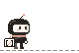

# The agent



ResearchAgent's one character, v2: a chunky pixel-art researcher, 32 × 40 px
standing at 1×. A big Ink hood frames a Paper visor that is its face: eyes that
blink, a little Salmon blush, and a small expression for every state. Its
antenna is the open-index mark's ascending route, rising from the hood at 45°
with a Salmon tip. The satchel at its hip carries the whole mark on a Paper
flap: two Ink source boundaries and the Salmon route. A Salmon scarf streams
back on the walk. The front leg is Ink and the back leg Slate, and a stride
is a row shorter than a pass, so the body dips on contact and rises as it
passes. A 1-px Paper rim around the whole silhouette keeps it legible on GitHub
dark (#0d1117) and light (#ffffff).

Brand tokens only (`palette` from `design/cast/build-cast.mjs`, plus the brand's
#655D55 secondary and a ledger grey midway between #C9BFB2 and #655D55); no cool
accent was needed. Format and warmth were inspired by an owner-supplied README
reference; the shapes, face and palette are original. v1 (16 × 24, head as the
mark) vs v2: [docs/evidence/character](../../docs/evidence/character/README.md#v1--v2).

## Poses

One row per animation in `sprite-sheet.png` (64 × 48 cells; `sprite-atlas.json`
has rects and durations):

| Row | Frames | Story | Face |
| --- | --- | --- | --- |
| idle | 4 | antenna sways, one blink | neutral, blink |
| walk | 4 | stride, pass, stride, pass; scarf streams, arm swings | neutral |
| search | 4 | magnifier over a locked page; hidden lines stay grey | squint |
| thinking | 4 | hand to chin, dots count up, antenna tip lights: deciding what is worth buying | eyes up |
| pay | 4 | coin from hand into the escrow lock's slot; the slot turns Salmon | focus, then smile |
| key-reveal | 4 | the writer's key drops in and turns; shackle opens, page lines turn Ink | "o", then happy |
| verified | 4 | carries the unlocked page; green check badge | happy |
| refund | 4 | broken promise (red ×, red keyhole); the coin returns to the hand | frown, then relief |

`hero.gif` (README, 672 × 92) walks the dashed ledger line to the locked page,
searches, decides, pays into the lock, the key turns, and it walks off with the
verified page. That segment of the ledger turns Salmon and stays: the proof is
anchored. `loop.gif` is the same story in place for the explainers site;
`state-search.gif` and `state-thinking.gif` are small app-state loops.

## LinkedIn

In `social/`, generated with everything else:

- `agent-1080.png` and `agent-1080.gif`: 1080 × 1080, transparent. Idle, a
  blink and a wave, then a walk on a scrolling ledger (15×).
- `banner-1200x627.gif`: the story strip at 5× on Paper, under the lockup and
  "Research with a wallet."
- `portrait-1080x1350.png`: the verified pose at 12× above search, decide, pay
  and key-turn frames.

Text is Geist Regular outlined from `site/brand/geist-latin-wght-normal.woff2`.
Both Paper exports say "Illustration · payments run on XRPL Testnet, no real
value". Each GIF is under 5 MB; the generator fails if one is not.

## Use

- App: `<AgentSprite animation="search" />` (`src/components/AgentSprite.tsx`)
  steps through one sheet row with CSS `steps()`, holding frame 0 under
  `prefers-reduced-motion`. Default scale is 1 (64 × 48). It is an
  illustration only: it never starts a payment or implies settlement, and it
  never replaces a real label, receipt or ledger link.
- Site: `site/brand/agent-loop.gif` with `agent-still.png` for reduced motion.
- Reduced-motion stills: `idle.png` (standing, 4×) and `hero-still.png` (the
  hero's opening frame, same size as `hero.gif`).
- Scale only by integers with nearest-neighbour (`image-rendering: pixelated`).
- The logo stays the open-index mark and lockup in `design/brand/`.

## Regenerate

```
node design/character/build-character.mjs          # write every export
node design/character/build-character.mjs --check  # fail on drift
```

Frames are character grids in the generator, PNGs use `node:zlib`, GIFs use the
generator's own LZW encoder (16-colour table, index 0 transparent, disposal 2
on transparent GIFs, changed-rectangle frames on Paper, infinite loop). Text
for the social exports uses `fontkit`, the brand build's locked dev
dependency; nothing new is installed. `tests/character.test.tsx` runs the drift
check in `npm run check:fast` and CI. Evidence and file sizes:
[docs/evidence/character](../../docs/evidence/character/README.md).
