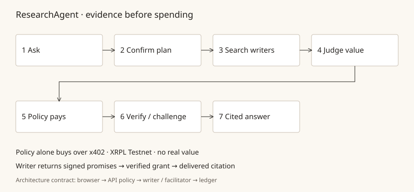

# What ResearchAgent can do, with evidence

Every row links to committed evidence. Labels are part of the claim: **synthetic** and
**fixture** mean a fictional corpus and substituted providers, **simulated** means no
ledger, **local** means one development host, **Testnet** means XRPL Testnet with no
real value. Start with the [README](../README.md) for the short version.

## How a run works

The browser is a view. The API owns retrieval, decisions, budget, payment and synthesis.
Each writer searches their own full text and returns a signed manifest; a 5 s plan modal
confirms before any spending; the decision model scores value; policy code pays over x402
v2, at most one article per round and up to three rounds; the delivered article is checked
against the signed promises, and broken ones are challenged and refunded. DeepSeek writes
the answer only from evidence the run actually holds, with citations.
[Architecture and trust boundaries](contracts/ARCHITECTURE.md) ·
[x402, verification and refunds](x402-xrpl.md) · [Key-reveal escrow](key-reveal-escrow.md) ·
[Security](contracts/SECURITY.md).

## Capabilities

| Capability | Result | Scope | Evidence |
|---|---|---|---|
| Key-reveal escrow | Default in `make testnet`, `try` and the zero-clone app; live activity and receipts show create, key publication and policy checks. Opt out: `ESCROW_MODE=payment make testnet`. | Testnet, synthetic articles | [Autoplay key reveal](https://collaboration95.github.io/theFastandtheFungible/demo/?scenario=UC-key-reveal) · [Live ledger proof](https://collaboration95.github.io/theFastandtheFungible/ledger/) |
| TEST-SGD token escrow | `make testnet ARGS=--iou`; S$ prices map 1:1; issuer permission, trust lines and ledger balance deltas checked. | TEST-SGD · IOU issued by our Testnet issuer · no real value · stand-in for RLUSD | [Mechanism](key-reveal-escrow.md) |
| Independent writers in one search | Three pinned origins; writers with identical writer, article and span IDs stay distinct through policy, grants, citations and receipts. Ten parallel retries per intent plus a restart give one receipt per intent. | local, simulated | [round2-f](evidence/round2-f/README.md) |
| "What your money bought" | 30 paid claim-to-passage links in three scenarios; each quotes one delivered span, and mutated receipts are rejected. Semantic value is shown as "not assessed". | synthetic | [round2-g](evidence/round2-g/README.md), [contract](contracts/CONTRIBUTION.md) |
| Two independent receipt verifiers | TypeScript and a Python verifier (own Ed25519 and secp256k1 checks) agree on all <!--f:vectors-->224<!--/f--> shared conformance cases: <!--f:vectors_golden-->19<!--/f--> that must pass and <!--f:vectors_tampered-->205<!--/f--> tampered ones that must fail. | local, offline | [round2-k](evidence/round2-k/README.md) (first 177), [key-reveal-escrow.md](key-reveal-escrow.md), [spec](receipt-spec.md) |
| Agent kill switch | An agent can pause its own spending (or the wallet, with an operator token); only a human can resume. In-flight unsigned purchases cannot sign. | fixture, simulated | [round2-i](evidence/round2-i/README.md) |
| BYOK | One OpenAI-compatible key runs research and a generic judge. That judge is labelled UNCALIBRATED and policy never lets it buy. Private and metadata addresses are refused before a socket opens. | synthetic providers | [round2-c1](evidence/round2-c1/README.md), [byok.md](byok.md) |
| Bounded engine | 3,000-run history load 34,372.8 ms → 313.3 ms (110×). 100 concurrent asks: 4 admitted, 96 typed 503. Stop cancels a stalled provider call in 5.5 ms with no signature after it. | local, synthetic | [round2-a](evidence/round2-a/README.md), [round2-c1](evidence/round2-c1/README.md) |
| Chaos and soak | Real SIGKILLs, zero double charges: a 30-minute soak ran 615 iterations and 155 kills; v0.7.0 recorded 1,729 episodes and 431 kills. The first long soak ended at a 606 s laptop sleep, which the write-up diagnoses. | fixture | [soak-nov4](evidence/soak-nov4.md), [chaos-279](evidence/chaos-279.md) |
| A Mac app that recovers | 13 packaged recovery cases pass: missing, locked or corrupt credentials, port conflict, outage and restart. All 13 privileged IPC methods reject the research window. | local, unsigned, fixture | [round2-c2](evidence/round2-c2/README.md) |
| Testnet ledger page | <!--f:transactions-->61<!--/f--> transactions re-validated live on load; WebSocket checks compare amounts, bindings and credential identity. Unavailable history stays labelled. | Testnet, no real value | [round2-p1](evidence/round2-p1/README.md), [live page](https://collaboration95.github.io/theFastandtheFungible/ledger/) |
| Hosted sandbox gateway | Opt-in `HOSTED=1`: per-visitor sessions, CSRF, per-question, per-visitor and whole-demo caps, a durable pause switch, owner routes disabled. | source; the public sandbox is open 13–19 Nov 2026 | [hosted-web.md](hosted-web.md) |
| Ranked builder feedback | <!--f:feedback_line-->7 ranked findings with runnable repros · 35 numbered findings (B01–B35) · 15 September submissions (4–5 Sep) · 8 upstream drafts, 0 filed<!--/f-->. Each has a workaround, a suggested fix and its mainnet consequence. | observed and code-derived, labelled | [BUILDER-FEEDBACK](BUILDER-FEEDBACK.md) |

## XRPL primitives used, and why

All on XRPL Testnet, no real value; synthetic articles.

- [Payment + InvoiceID](https://testnet.xrpl.org/transactions/1F2449A4660747066E99A89CEA5B49276D266F35820789042A8694EDB1DA23AF) binds a payment to the quoted content.
- [EscrowCreate + PREIMAGE-SHA-256](https://testnet.xrpl.org/transactions/C82B337DC66343C64F653E86627E590434670E48AC4526369338ED1099A25926) locks XRP until the writer publishes the article key, or until an explicit buyer-controlled cancellation.
- [RLUSD payment](https://testnet.xrpl.org/transactions/3232360079F218229444F11B9945D0E5F29284FDCD7808AE5FB8D3AE9290F6AA) (issued currency, checked against the exact validated `delivered_amount`).
- [CredentialCreate/Accept](https://testnet.xrpl.org/transactions/225F19ED4BF1C206AE140D5286BE352F2F6E7A7A05A317D949DAEE876E98DAC6) identifies accepted writer credentials, independently of content quality ([evidence](evidence/round2-n/README.md)).
- [x402 v2](https://testnet.xrpl.org/transactions/FE6EF0F8785B4FC776551B378B62B8E9BA480D17FA375A3BB637FCE310AD1373) carries the challenge, signed-payment and settlement headers.
- [Starter Kit t54](https://testnet.xrpl.org/transactions/570DE6EB58157FB8C5D1F8E23ECAF0A8340750ADFCB6A238CB8E70E2FD4B5588) interoperates with pinned `x402-xrpl` 0.3.4 ([compatibility](x402-xrpl.md#starter-kit-compatibility), [evidence](evidence/starter-kit-interop.md)).

Contract: [x402-xrpl.md](x402-xrpl.md).

## Real writers

**real person · Testnet · no real value.** Writers who have given consent to be listed
appear here and on the [ledger page](https://collaboration95.github.io/theFastandtheFungible/ledger/),
read only from [`evidence/real-writers.json`](evidence/real-writers.json)
([schema](evidence/real-writers.schema.json)). The list is empty today: it waits for
consenting writers, and the fictional corpus is never mixed into it. The onboarding run in
[`evidence/round3-c/`](evidence/round3-c/) used a synthetic starter and a public-faucet
wallet.
