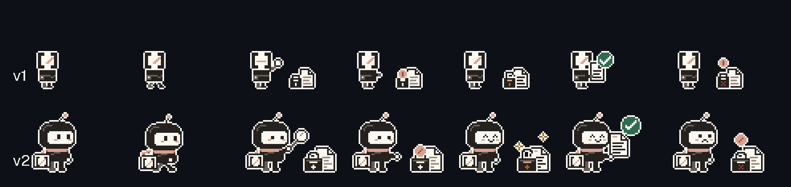
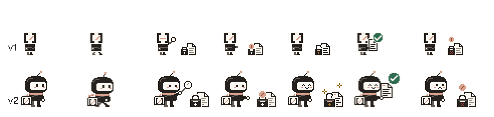
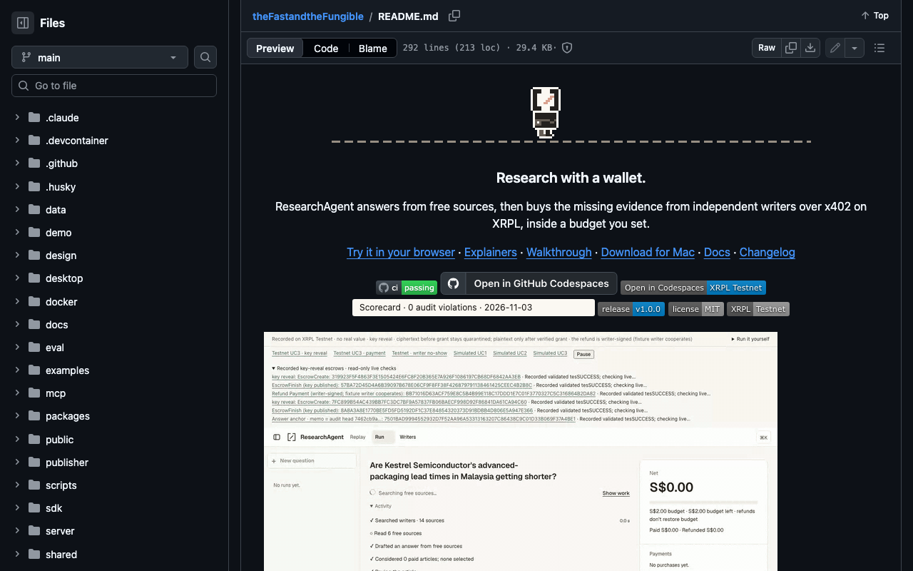
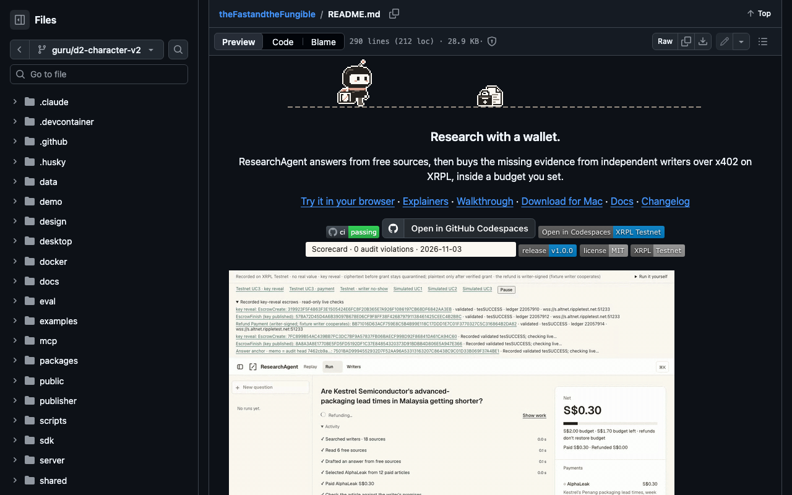

# Character evidence

Generated by `node design/character/build-character.mjs`; do not edit by hand.
`node design/character/build-character.mjs --check` (also run by
`tests/character.test.tsx` in `npm run check:fast` and CI) fails if any committed
export drifts from the generator. GIF, JSON and Markdown are compared byte for
byte; PNGs by decoded RGBA, because PNG bytes depend on the zlib build.

## v1 → v2

Top row v1 (16 × 24 agent, merged in #385), bottom row v2 (32 × 40), same
states, both at 3×: idle, walk, search, pay, key reveal, verified, refund.
`v2/v1-sprite-sheet.png` is a frozen copy of the v1 sheet the comparison reads.

| GitHub dark #0d1117 | GitHub light #ffffff |
| --- | --- |
|  |  |

README at 1280 × 800 on github.com, dark, scrolled to the README's top.
Captures and measured positions: [v2/first-screen.md](v2/first-screen.md).

| v1 | v2 |
| --- | --- |
|  |  |

## Previews

| Preview | Background |
| --- | --- |
|  | GitHub dark #0d1117 |
|  | GitHub light #ffffff |
|  | key frames, dark |
|  | key frames, light |
|  | sprite sheet ×3, dark |
|  | sprite sheet ×3, light |

## Exports

Integer nearest-neighbour scaling, a 16-colour global table of brand tokens,
infinite loop. Transparent GIFs use index 0 and disposal 2 on every frame,
cropped to opaque bounds. The banner and the two evidence previews are opaque:
the first frame is whole and later frames carry only the changed rectangle
(disposal 1).

| File | Pixels | Frames | Loop | Size |
| --- | --- | --- | --- | --- |
| `design/character/hero.gif` | 672×92 | 151 | 18.76 s | 163.9 KB |
| `design/character/loop.gif` | 160×108 | 22 | 5.16 s | 19.5 KB |
| `design/character/state-search.gif` | 128×96 | 4 | 0.72 s | 3.3 KB |
| `design/character/state-thinking.gif` | 128×96 | 4 | 1.04 s | 3.2 KB |
| `design/character/social/agent-1080.gif` | 1080×1080 | 26 | 4.40 s | 193.5 KB |
| `design/character/social/banner-1200x627.gif` | 1200×627 | 119 | 15.56 s | 133.7 KB |
| `docs/evidence/character/hero-on-dark.gif` | 672×92 | 151 | 18.76 s | 72.5 KB |
| `docs/evidence/character/hero-on-light.gif` | 672×92 | 151 | 18.76 s | 72.5 KB |
| `design/character/social/agent-1080.png` | 1080×1080 | 1 | still | 8.4 KB |
| `design/character/social/portrait-1080x1350.png` | 1080×1350 | 1 | still | 27.3 KB |
| `design/character/hero-still.png` | 672×92 | 1 | still | 0.5 KB |
| `design/character/idle.png` | 256×192 | 1 | still | 0.9 KB |

Budgets, enforced by the generator: `hero.gif` under 400 KB, each social GIF
under 5 MB.

## Sprite sheet

`design/character/sprite-sheet.png` is 256×384 at 1×: 8 rows of
64×48 cells, one animation per row (idle 4×350 ms, walk 4×120 ms, search 4×180 ms, thinking 4×260 ms, pay 4×160 ms, key-reveal 4×220 ms, verified 4×300 ms, refund 4×200 ms).
`sprite-atlas.json` lists every frame rect and duration.
