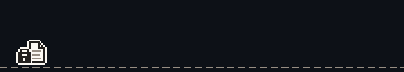
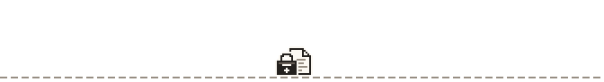
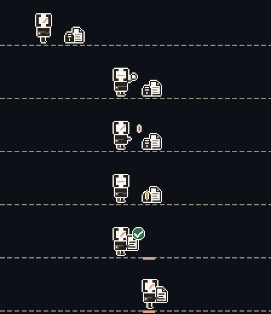
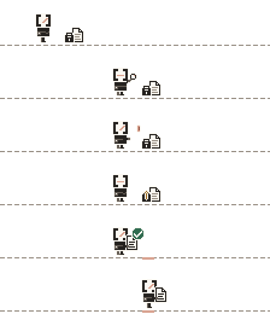
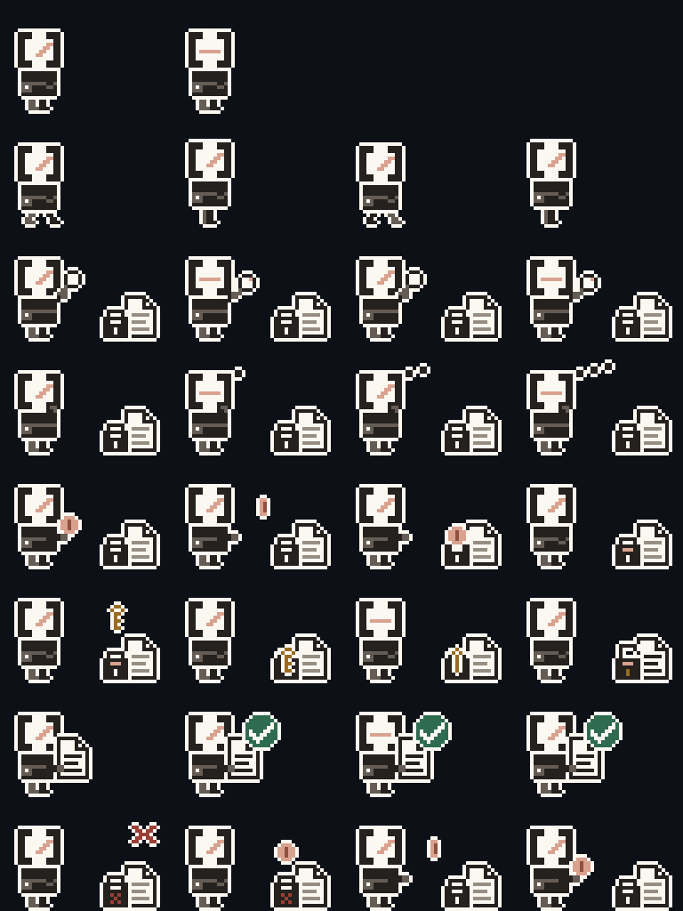
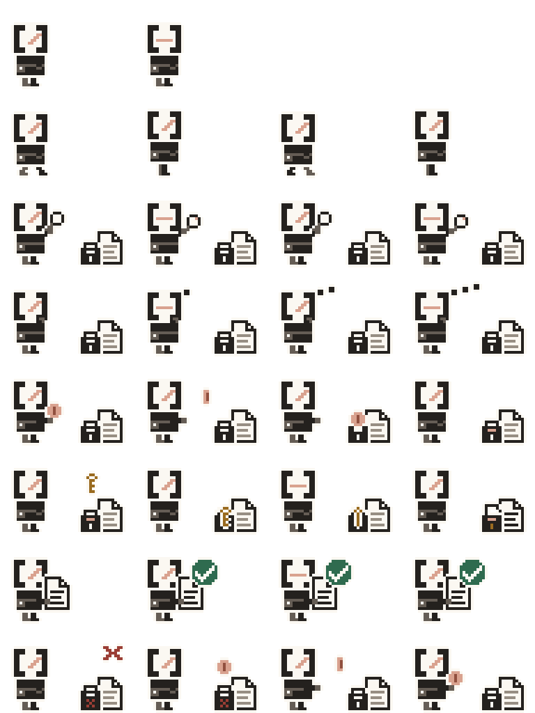

# Character evidence

Generated by `node design/character/build-character.mjs`; do not edit by hand.
`node design/character/build-character.mjs --check` (also run by
`tests/character.test.ts` in `npm run check:fast` and CI) fails if any committed
export drifts from the generator. GIF, JSON and Markdown are compared byte for
byte; PNGs by decoded RGBA, because PNG bytes depend on the zlib build.

| Preview | Background |
| --- | --- |
|  | GitHub dark #0d1117 |
|  | GitHub light #ffffff |
|  | key frames, dark |
|  | key frames, light |
|  | sprite sheet ×4, dark |
|  | sprite sheet ×4, light |

## GIF exports

All transparent except the two evidence previews. Integer nearest-neighbour
scaling, a 16-colour global table of brand tokens, index 0 transparent,
disposal 2 on every frame, infinite loop.

| File | Pixels | Frames | Loop | Size |
| --- | --- | --- | --- | --- |
| `design/character/hero.gif` | 672×120 | 78 | 10.91 s | 89.0 KB |
| `design/character/loop.gif` | 192×108 | 18 | 4.80 s | 15.5 KB |
| `design/character/state-search.gif` | 96×64 | 4 | 0.72 s | 1.9 KB |
| `design/character/state-thinking.gif` | 96×64 | 4 | 1.04 s | 1.8 KB |
| `docs/evidence/character/hero-on-dark.gif` | 672×120 | 78 | 10.91 s | 95.7 KB |
| `docs/evidence/character/hero-on-light.gif` | 672×120 | 78 | 10.91 s | 95.7 KB |

Budget: `hero.gif` under 400 KB.

## Sprite sheet

`design/character/sprite-sheet.png` is 192×256 at 1×: 8 rows of
48×32 cells, one animation per row (idle 2×400 ms, walk 4×110 ms, search 4×180 ms, thinking 4×260 ms, pay 4×160 ms, key-reveal 4×220 ms, verified 4×300 ms, refund 4×200 ms).
`sprite-atlas.json` lists every frame rect and duration.
