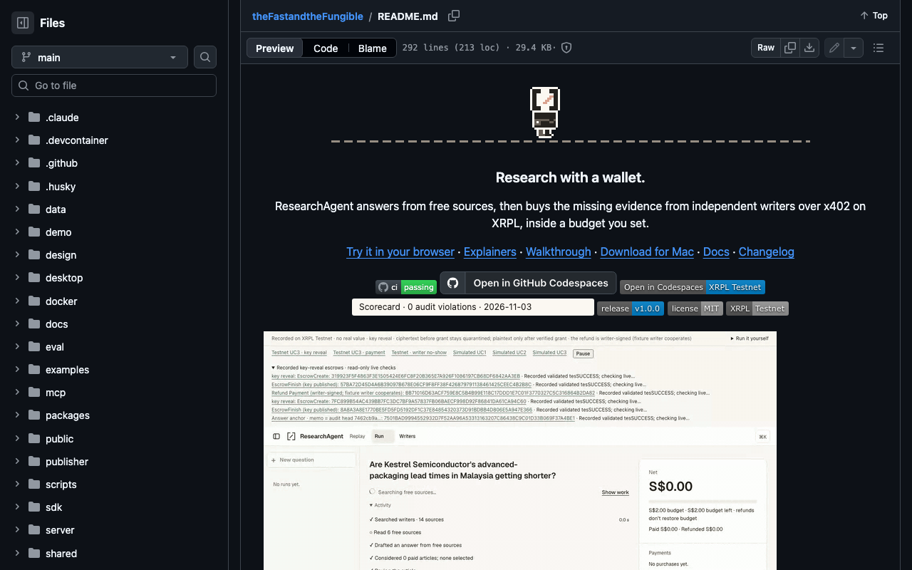
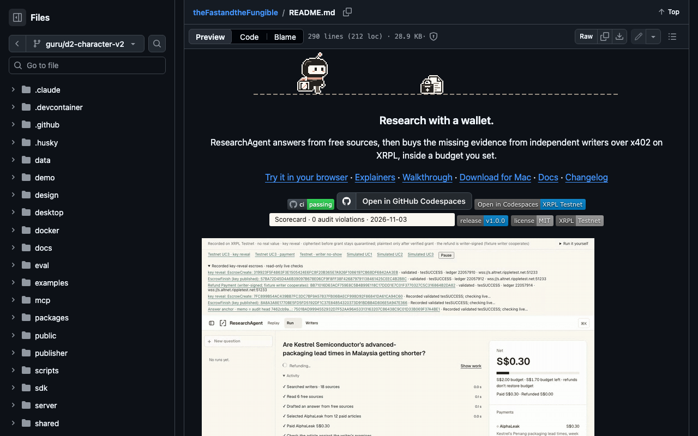

# README first screen, v1 vs v2

Captured 7 Nov 2026 with Playwright Chromium at 1280 × 800, `colorScheme: dark`,
on github.com's README view (`/blob/<ref>/README.md`), scrolled so the README
starts 16 px under the sticky header. Positions are px from the viewport top.

| | Hero | Testnet proof GIF | "Verify in 30 s" heading | Verify table |
| --- | --- | --- | --- | --- |
| v1 (`main`, 672 × 120 hero) | 86–206 | 465–915 | 1033–1058 | 1074–1550 |
| v2 (this branch, 672 × 92 hero) | 86–178 | 437–887 | 1005–1030 | 1046–1522 |

The v2 hero is 28 px shorter, so everything below it moves up 28 px. The proof
GIF starts on the first screen in both, and 87 px of its 450 px falls below
the fold in v2 (115 px in v1). The "Verify in 30 s" table was already below
800 px in v1 and still is: bringing it onto the first screen needs edits to
README sections other than the hero line, which this change does not touch.

| v1 | v2 |
| --- | --- |
|  |  |
