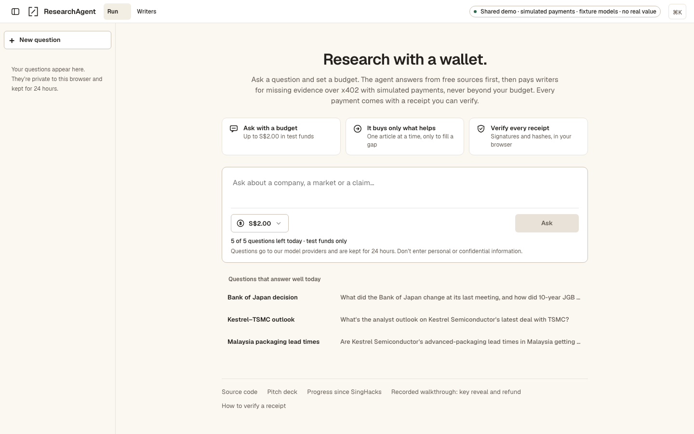
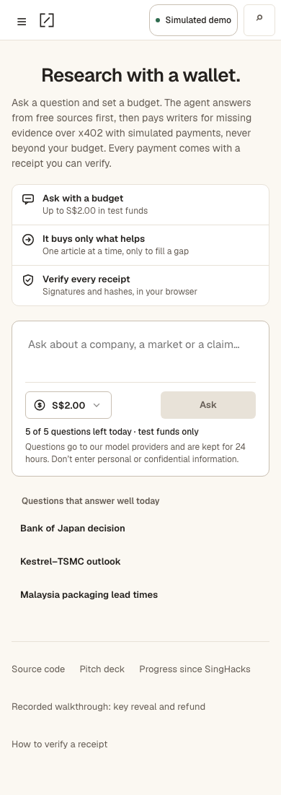
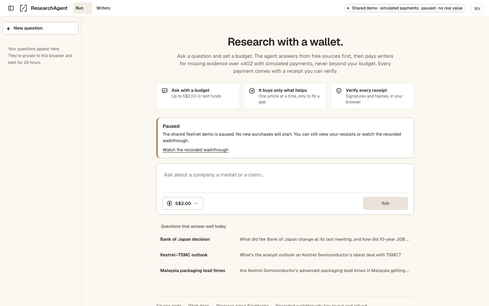
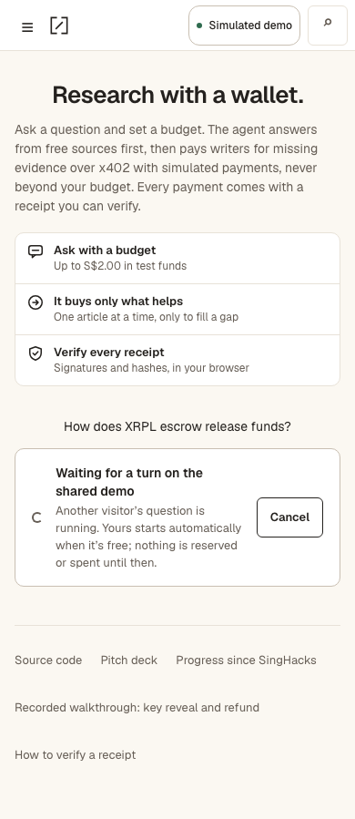
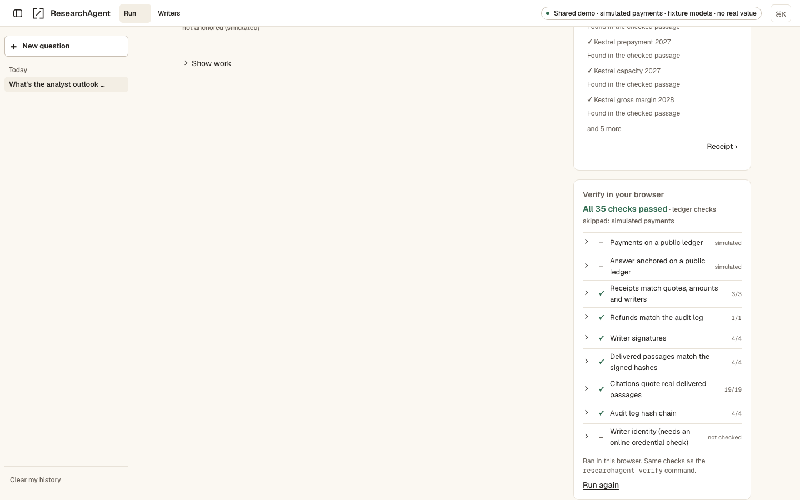

# Hosted judge UI (lane HU) · 11 Nov 2026

What a judge sees at the hosted URL. When `GET /api/demo/status` answers (HG, [#432](https://github.com/Collaboration95/theFastandtheFungible/pull/432)), the web app renders the hosted shell. When it returns 404, local and desktop render exactly as before.

**Scope of this evidence:** a local hosted stack (`HOSTED=1`, fixture models, simulated rail, a self-signed HTTPS origin), never a deployment. The ledger checks were exercised separately against recorded Testnet receipts (see "Verify on XRPL in your browser" below). Live models and the shared Testnet sponsor wallet are not covered here; deployed acceptance remains with ops ([hosted-web.md](../../hosted-web.md)).

## Reproduce

```sh
npx playwright test --config tests/playwright/hosted.config.ts                     # 5 tests, about 15 s after the build
UPDATE_EVIDENCE=1 npx playwright test --config tests/playwright/hosted.config.ts   # refresh the screenshots below
```

The local gate runs the same suite as the `browser-hosted` step. The stack (`tests/helpers/hosted-stack.ts`) uses ephemeral ports, a throwaway certificate and its own state directory. It loads no `.env`. Readiness is the only thing it overrides: a flag file stands in for the funded-payer probe, and pausing uses the real operator control file.

## What the suite checks

| Test | Checks |
|---|---|
| First visit (1440) | One-line orientation, three steps, then the visitor's own question with the S$2.00 budget cap and "5 of 5 questions left today"; no dialog on load; one environment indicator ("Shared demo · simulated payments · fixture models · no real value") whose details open on demand and return focus; no Settings, no Record, Presenter or Connect in ⌘K, ⌘, does nothing, `?record=1` is stripped and `?settings=1` is ignored; footer links; axe has no serious or critical issues |
| 390 px | No horizontal scroll, composer within the first screen and a half, axe clean, reduced motion |
| Ask → verify, two visitors | Kestrel example → plan (no Edit: hosted re-plans on the server) → answer. **Verify in your browser** reports "All 35 checks passed · ledger checks skipped: simulated payments", and simulated runs never claim XRPL Testnet. No PDF. A second browser context sees an empty sidebar, and A's `?run=` link shows "That question isn’t available here." A's allowance drops to 4 of 5. **Clear my history** hides the finished run |
| States | Paused (exact copy, from the control file, recovers on its own), on hold (degraded), offline (`context.setOffline`), server not responding (status aborted after load), allowance used up and ended (status as reported). Never "Can't reach the server" |
| Busy | A `busy` refusal shows "Waiting for a turn on the shared demo" with Cancel. The question is kept, the spinner is still under reduced motion, axe clean |

Stop wording for each payment phase (not paid, on its way, paid and delivered, delivery failed, refund requested or refused, refunded, escrow locked, cancel due or cancelled) is covered by unit tests in `src/hosted.test.tsx`. Unsettled payments always read "still being checked", never a final word.

## Screenshots

| | |
|---|---|
|  |  |
|  |  |
|  | |

## Verify on XRPL in your browser

The run page downloads `/runs/:id/receipts.json` and runs the same `sdk/verify.ts` `verifyAnswer` as `researchagent verify --ledger`, inside the browser. That code sits in a lazy chunk (174 KB gzip), which loads only when the visitor clicks **Run the checks**. Ledger reads are read-only `tx` lookups over WebSocket to `wss://s.altnet.rippletest.net:51233`, with the Clio node as fallback. Testnet hosts only; nothing is signed or submitted. Node-only pieces are swapped at build time:

- `node:crypto` becomes SHA-256 from `@noble/hashes`. AES-256-GCM decryption of published keys runs through WebCrypto, with the authentication tag checked, before verification starts.
- `ws` becomes the browser WebSocket.
- `Buffer` becomes a small byte shim.

`src/hosted.test.tsx` checks the shims against Node's `crypto` and `Buffer`, and checks that a forged GCM tag fails closed.

**Parity on recorded Testnet receipts** (`docs/evidence/round4-j1/replays/key-reveal/UC3.receipts.json`, key reveal and refund):

| Verifier | Result |
|---|---|
| Node, `verifyAnswer(..., { onlineLedger: true })` | PASS. 12/12 Testnet transactions found; anchor in ledger 22128655 |
| Chromium, production verifier chunk | `ok: true`, 58 checks. Every group passes (ledger, anchor, receipts, refunds, published keys, signatures, passages, citations, audit chain), reading `s.altnet.rippletest.net`. No console errors |

Writer identity needs an online credential lookup, so it shows as "not checked" and never counts as passed.

## Budget

Initial JS is about 152 KB gzip (app 147.9 + index 3.1 + palette 1.1), within the 170 KB budget (main was 142.6 KB). The verifier is not part of the initial load.
